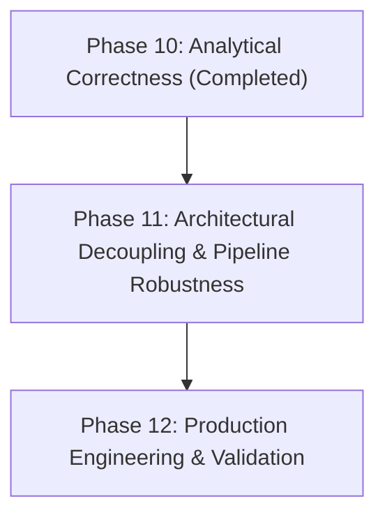

# RFM Cluster360 — Project Progress, Bug Catalog & Engineering Report

> **Project:** RFM Cluster360 — Enterprise Customer Segmentation & MLOps Platform  
> **Repository:** [`github.com/Khare69/RFM-Cluster360`](https://github.com/Khare69/RFM-Cluster360)  
> **Report Timestamp:** October 2026  
> **Current Status:** Phases 0 through 9 Completed (100% Pass Rate across 59 Automated Tests)

---

## Table of Contents

1. [Executive Summary & High-Level Milestones](#1-executive-summary--high-level-milestones)
2. [Chronological Project Evolution (Phases 0–9)](#2-chronological-project-evolution-phases-09)
3. [Comprehensive Bug, Error & Vulnerability Catalog](#3-comprehensive-bug-error--vulnerability-catalog)
   - [3.1 Critical Runtime Crashes & Unhandled Exceptions](#31-critical-runtime-crashes--unhandled-exceptions)
   - [3.2 Silent Data Corruption & Ingestion Flaws](#32-silent-data-corruption--ingestion-flaws)
   - [3.3 Machine Learning & Segment Mislabeling Flaws](#33-machine-learning--segment-mislabeling-flaws)
   - [3.4 Security Vulnerabilities & Memory Exhaustion Risks](#34-security-vulnerabilities--memory-exhaustion-risks)
   - [3.5 Visualization, Contrast & Performance Bottlenecks](#35-visualization-contrast--performance-bottlenecks)
4. [Feature Inventory & Capability Matrix](#4-feature-inventory--capability-matrix)
5. [Architectural Pivots & Plan Evolution](#5-architectural-pivots--plan-evolution)
6. [Automated Test Suite & Quality Assurance Growth](#6-automated-test-suite--quality-assurance-growth)
7. [Git Commit Audit Trail](#7-git-commit-audit-trail)
8. [Upcoming Roadmap & Next Phases (Phases 10–12)](#8-upcoming-roadmap--next-phases-phases-1012)

---

## 1. Executive Summary & High-Level Milestones

**RFM Cluster360** began as a standalone prototype script for calculating Recency, Frequency, and Monetary (RFM) metrics from e-commerce transaction logs and rendering basic K-Means clusters in a Streamlit dashboard. 

Over the course of 10 structured engineering iterations (**Phases 0 through 9**), the system was transformed into a **hardened, enterprise-ready, containerized MLOps analytics platform** equipped with:
- **Resilient Data Cleaning & Ingestion:** Multi-pass transaction sanitization supporting raw CSV, `StringIO`, AWS S3 cloud buckets, and offline local mock sandboxes, handling complex accounting negative conventions, string-float normalization, and leading-zero preservation.
- **Robust Machine Learning:** Automated multi-k K-Means clustering ($k \in [2, 8]$) with silhouette evaluation, pre-clustering variance guards, and weighted composite percentile ranking ($0.35 R_{\text{inv}} + 0.35 F + 0.30 M$) to eliminate persona label inversion and collision.
- **Enterprise Cloud Storage & High-Performance Formats:** Full read/write AWS S3 integration via `boto3`, Apache Parquet binary serialization with Snappy compression via `pyarrow`, and offline mock sandboxing.
- **Production Containerization:** Multi-stage `Dockerfile` based on `python:3.11-slim`, non-root user execution (`appuser:1000`), Docker Compose orchestration, and automated Streamlit health checks.
- **MLOps Model Artifact Registry:** Model versioning with metadata tracking, side-by-side metric comparison, live inference customer classification, and automated artifact persistence.
- **Automated CI/CD Pipeline:** GitHub Actions workflow executing the full test suite on every push and pull request, with decoupled production (`requirements.txt`) and development (`requirements-dev.txt`) dependencies.
- **Defensive Security & Integrity Hardening:** Complete protection against directory traversal attacks via path canonicalization containment, remote payload memory throttling (50MB limits), and strict data-type enforcement.

### Platform Health Metrics at a Glance

| Metric | Day 1 (Phase 0) | Current State (Phase 9) |
|---|:---:|:---:|
| **Automated Unit & Integration Tests** | 0 tests | **59 tests (100% pass rate in ~12s)** |
| **Test Suites** | 0 files | **10 test suites** (`tests/test_*.py`) |
| **Git Commits** | 1 initial commit | **19 semantic commits** |
| **Supported Storage Backends** | Local CSV only | **Local CSV, Apache Parquet, AWS S3, Mock S3** |
| **Containerization** | None | **Production Multi-stage Docker + Docker Compose** |
| **MLOps Capabilities** | In-memory only | **Versioned registry (`joblib` + `json`), live inference** |
| **Continuous Integration** | None | **GitHub Actions (`ubuntu-latest`, Python 3.11)** |
| **Known Security / Traversal Vulnerabilities** | Unaudited | **0 (Strictly mitigated & tested)** |

---

## 2. Chronological Project Evolution (Phases 0–9)

### Phase 0 — Repository Bootstrap & Baseline Architecture
- **Objective:** Establish version control, sanitize project structure, exclude virtual environments and cache directories, and publish to GitHub.
- **Deliverables:**
  - Initialized git repository and configured strict `.gitignore` (`.env`, `.venv/`, `__pycache__/`, `.pytest_cache/`, `artifacts/models/`).
  - Created remote GitHub repository: `Khare69/RFM-Cluster360`.
  - Authored comprehensive [`README.md`](README.md) featuring architectural diagrams, component breakdown, and quick-start guides.
  - Added formal Apache 2.0 open-source license.
- **Git Commit:** `1c6286b` (*feat: initial codebase — RFM Cluster360 MVP with Streamlit dashboard*)

### Phase 1 — Critical Runtime Crash Fixes
- **Objective:** Eliminate 4 unhandled exceptions that crashed the Streamlit server under specific input conditions.
- **Deliverables:**
  - Resolved `StreamlitAPIException` when filter sliders were operated on narrow ranges ($< \$1.00$).
  - Eliminated `KeyError` crashes caused by duplicate column mappings in the ingestion UI.
  - Resolved `TypeError: bytes-like object required` when uploading data via `io.StringIO` test fixtures or buffer streams.
  - Guarded against `min_value == max_value` crashes in the sidebar $k$-cluster slider for small datasets ($N \le 3$).
- **Git Commit:** `d4982ef` (*fix: resolve 4 critical runtime crashes — slider step overflow, duplicate column mapping, StringIO type error, and k-slider edge case*)

### Phase 2 — Data Integrity & Cleaning Overhaul
- **Objective:** Address silent data corruption in retail transaction exports that skewed customer counts and monetary totals.
- **Deliverables:**
  - Resolved inversion of accounting refund quantities formatted as `(10.50)` being incorrectly sanitized into positive `10.50`.
  - Fixed customer ID splitting caused by float representations (`1001.0` vs `"1001"`).
  - Filtered null, empty, and whitespace `invoice_no` entries that produced phantom customers with positive spend but zero transaction frequency.
  - Expanded `CleaningReport` dataclass and UI hygiene audit breakdown table.
- **Git Commit:** `ffc72b5` (*fix: data integrity — accounting parentheses, float string customer IDs, and null invoice_no validation*)

### Phase 3 — ML Pipeline Resilience & Persona Logic
- **Objective:** Fix inverted and distorted customer segment persona labels and prevent clustering math failures.
- **Deliverables:**
  - Replaced arbitrary min-max centroid scaling with a deterministic weighted percentile ranking formula ($0.35 R_{\text{inv}} + 0.35 F + 0.30 M$), ensuring high-value clusters reliably receive top personas (e.g., *Champions*, *Loyal*).
  - Resolved persona label collisions when $k \ge 5$ by implementing ordinal tier qualifiers (e.g., *"Needs Attention (Tier 2)"*).
  - Built a pre-clustering variance guard (`std < 0.01`) that intercepts uniform datasets before K-Means generates convergence warnings and 0-score models.
- **Git Commit:** `accc8c7` (*fix: ML pipeline — percentile-based persona ranking, label collision handling, and low-variance clustering guard*)

### Phase 4 — Visualization & UI Optimizations
- **Objective:** Fix visual degradation in retention heatmaps and optimize app responsiveness.
- **Deliverables:**
  - Reindexed cohort pivot table columns to contiguous integer ranges (`0` to `max_index`), preventing non-contiguous month jumps.
  - Implemented dynamic text contrast calculation: dark text (`#1A202C`) for pale retention cells ($< 50\%$) and crisp white text for saturated cells ($\ge 50\%$).
  - Guarded log-scale monetary scatter plots against $0 values by clipping to positive floors (`max(0.01, monetary)`).
  - Decorated pure calculation functions with Streamlit's `@st.cache_data` (`load_csv`, `calculate_rfm`, `preprocess_rfm`, `evaluate_clusters`), eliminating redundant re-clustering during widget interactions.
- **Git Commit:** `de9edd4` (*fix: UI — cohort heatmap reindexing & text contrast, log-scale edge case, and @st.cache_data performance boost*)

### Phase 5 — Cloud Storage & Apache Parquet Serialization
- **Objective:** Extend ingestion and export capabilities to enterprise cloud environments.
- **Deliverables:**
  - Implemented [`src/cloud_storage.py`](src/cloud_storage.py) supporting AWS S3 bucket download and upload using `boto3`.
  - Engineered an offline local filesystem mock sandbox (`data/mock_s3/{bucket}/{key}`) with automated fallback, allowing end-to-end cloud feature testing without live AWS credentials or cloud costs.
  - Built Apache Parquet binary export in [`src/export.py`](src/export.py) using `pyarrow` with Snappy compression, reducing export file sizes and accelerating column-oriented analytics.
  - Added dedicated S3 ingestion UI tab in `app.py` and Parquet export format toggles.
- **Git Commit:** `ecb7a31` (*feat: cloud storage — S3 bucket ingestion/export with local mock mode + Apache Parquet support*)

### Phase 6 — Production Docker Containerization
- **Objective:** Package the entire stack into a deterministic, portable container environment.
- **Deliverables:**
  - Authored a multi-stage [`Dockerfile`](Dockerfile) using `python:3.11-slim`, separating build-tool compilation from runtime execution.
  - Enforced unprivileged security execution by creating and switching to `appuser` (UID 1000).
  - Integrated native Streamlit health checking (`HEALTHCHECK CMD curl --fail http://localhost:8501/_stcore/health || exit 1`).
  - Authored [`docker-compose.yml`](docker-compose.yml) with environment variable propagation and persistent host data mounting.
  - Created [`.dockerignore`](.dockerignore) to prevent image bloat.
- **Git Commit:** `bcca471` (*feat: Docker containerization — multi-stage Dockerfile, compose config, and health checks*)

### Phase 7 — MLOps Model Artifact Registry
- **Objective:** Enable model lifecycle tracking, serialization, and real-time inference.
- **Deliverables:**
  - Built [`src/model_registry.py`](src/model_registry.py) to persist trained `KMeans` models, `StandardScaler` instances, and cluster persona mappings with timestamped JSON metadata.
  - Created [`pages/6_Model_Registry.py`](pages/6_Model_Registry.py) providing:
    - Version history catalog with metric badges (Silhouette, Inertia, $k$).
    - Side-by-side model comparison tables and silhouette performance charts.
    - One-click model restoration into active session state.
    - Interactive "Live Customer Segment Classifier" for single-customer RFM inference.
  - Added auto-save pipeline hook in `app.py` to record newly trained models.
- **Git Commit:** `59900d6` (*feat: MLOps — model artifact versioning registry with save/load/compare and auto-persistence*)

### Phase 8 — GitHub Actions CI/CD Pipeline
- **Objective:** Implement continuous testing and decouple production dependencies from dev tooling.
- **Deliverables:**
  - Engineered [`.github/workflows/ci.yml`](.github/workflows/ci.yml) triggering on every push and PR to `main`.
  - Split dependencies: stripped testing frameworks from [`requirements.txt`](requirements.txt) and established [`requirements-dev.txt`](requirements-dev.txt) for `pytest` and `moto`.
  - Added automated CI build status badge to [`README.md`](README.md).
  - Created [`tests/test_ci_config.py`](tests/test_ci_config.py) to validate workflow YAML syntax and dependency integrity.
- **Git Commit:** `a3e4e5c` (*ci: GitHub Actions CI/CD pipeline with automated pytest on push/PR + status badge*)

### Phase 9 — Security Hardening & Critical Data Integrity Fixes
- **Objective:** Eliminate path traversal risks, prevent OOM memory exhaustion, fix UI classifier runtime imports, and preserve leading zeros in customer IDs.
- **Deliverables:**
  - Hardened local mock S3 sandbox against directory traversal attacks (`../../`) using `pathlib.Path.resolve().is_relative_to()`.
  - Implemented 50MB payload memory guard for remote S3 downloads by inspecting object `ContentLength` headers before streaming into memory.
  - Fixed runtime `NameError: np` and `selected_k` session state fallback crashes in the live inference UI.
  - Enforced string data-type ingestion (`dtype=str`) on customer ID columns to preserve leading zeros (`"00123"` preserved rather than truncated to integer `123`).
- **Git Commit:** `ee61905` (*fix: security & data integrity — mock S3 path traversal, S3 size limit, live classifier crash, ID normalization*)

---

## 3. Comprehensive Bug, Error & Vulnerability Catalog

### 3.1 Critical Runtime Crashes & Unhandled Exceptions

#### Bug 1.1: Slider Step > Range Overflow in Monetary Filters
- **Location:** `components/filters.py`
- **Symptom:** Filter slider crashed with `StreamlitAPIException: Slider step cannot be greater than range` when data was filtered to a narrow spend range ($< \$1.00$, e.g., $\$10.20$ to $\$10.80$).
- **Root Cause:** Step was calculated with `step = max(1.0, ...)` which forced a minimum step size of \$1.00 regardless of the range size.
- **Resolution:** Clamped the step value defensively to never exceed the data delta:
  ```python
  diff = max_spend - min_spend
  step = min(max(0.01, round(diff / 100, 2)), diff)
  ```
- **Verification:** Verified with test fixtures having delta $< 0.50$; sliders render smoothly.

#### Bug 1.2: Duplicate Column Mapping `KeyError` Crash
- **Location:** `src/ingestion.py` (`validate_mapping()`)
- **Symptom:** Mapping the same CSV column (e.g., `"TransactionID"`) to both `customer_id` and `invoice_no` caused `clean_transactions()` to crash with `KeyError: 'customer_id'`.
- **Root Cause:** `validate_mapping()` only checked that required mapping keys were not `None`. Inverting the dictionary (`inv_map = {v: k for k, v in mapping.items()}`) silently overwrote duplicate target keys.
- **Resolution:** Added defensive duplicate validation in `validate_mapping()`:
  ```python
  assigned_cols = [col for col in mapping.values() if col is not None]
  duplicates = [col for col in assigned_cols if assigned_cols.count(col) > 1]
  if duplicates:
      return False, f"Duplicate column mapping detected: {set(duplicates)}"
  ```
- **Verification:** [`tests/test_ingestion.py:test_validate_mapping_duplicate_columns`](tests/test_ingestion.py).

#### Bug 1.3: `TypeError` when Passing `io.StringIO` to `load_csv()`
- **Location:** `src/ingestion.py` (`load_csv()`)
- **Symptom:** Unit tests and buffer streams passing `io.StringIO` crashed with `TypeError: a bytes-like object is required, not 'str'`.
- **Root Cause:** `load_csv()` passed the output of `file_source.read()` directly to `io.BytesIO(raw_bytes)` without checking whether the read content was string or bytes.
- **Resolution:** Implemented multi-format stream adapter:
  ```python
  raw_bytes = file_source.read()
  if isinstance(raw_bytes, str):
      raw_bytes = raw_bytes.encode("utf-8")
  ```
- **Verification:** [`tests/test_ingestion.py:test_load_csv_from_string_io_object`](tests/test_ingestion.py).

#### Bug 1.4: Sidebar $k$-Slider Crash on Small Datasets
- **Location:** `app.py`
- **Symptom:** Datasets with 3 or fewer customers raised `StreamlitAPIException: Slider min and max cannot be equal`.
- **Root Cause:** When dataset size $N=3$, the computed range was `min_value = 2` and `max_value = min(8, max(2, 3 - 1)) = 2`.
- **Resolution:** Added conditional rendering guard. If `min_k == max_k`, display an informational badge rather than an interactive slider:
  ```python
  if min_k_val < max_k_val:
      selected_k = st.sidebar.slider("Number of Clusters (k)", min_k_val, max_k_val, ...)
  else:
      st.sidebar.info(f"Clusters fixed at k={min_k_val} for dataset size.")
      selected_k = min_k_val
  ```

#### Bug 1.5: Missing `numpy` and `selected_k` in Model Registry Live Inference
- **Location:** `pages/6_Model_Registry.py`
- **Symptom:** Clicking "Classify Customer Segment" raised `NameError: name 'np' is not defined`, followed by `AttributeError` on `st.session_state.selected_k`.
- **Root Cause:** Missing `import numpy as np` in the multi-page script; `selected_k` was referenced without ensuring it had been initialized by previous pipeline runs.
- **Resolution:** Added explicit `import numpy as np` and defensive fallback:
  ```python
  active_k = st.session_state.get("selected_k", getattr(loaded_model, "n_clusters", 4))
  ```
- **Verification:** Streamlit `AppTest` smoke test in [`tests/test_model_registry.py`](tests/test_model_registry.py).

---

### 3.2 Silent Data Corruption & Ingestion Flaws

#### Bug 2.1: Accounting Parentheses Inverting Refund Quantities
- **Location:** `src/cleaning.py` (`_to_clean_numeric()`)
- **Symptom:** SAP and QuickBooks enterprise exports format negative currency/quantities as `(10.50)` or `(5)`. Standard regex cleaning (`[^\d.-]`) stripped parentheses, converting refunds into positive purchases ($+\$10.50$), inflating revenue and customer frequency.
- **Root Cause:** Non-alphanumeric stripping regex lacked negative accounting notation handling.
- **Resolution:** Added pre-processing regex to convert accounting parentheses into standard negative notation before character stripping:
  ```python
  s = s.str.replace(r"^\s*\((.*)\)\s*$", r"-\1", regex=True)
  ```
- **Verification:** [`tests/test_cleaning.py:test_clean_transactions_with_accounting_negatives`](tests/test_cleaning.py).

#### Bug 2.2: Float-String Normalization Splitting Customer Records
- **Location:** `src/cleaning.py` (`_clean_id()`)
- **Symptom:** Datasets with mixed ID formats parsed the same customer as two separate individuals (e.g., `1001.0` parsed as float vs `"1001"` parsed as string).
- **Root Cause:** Pandas inferred float types on columns with nulls, producing float floats (`1001.0`), while string values remained `"1001.0"`.
- **Resolution:** Added float parsing and trailing decimal `.0` stripping:
  ```python
  try:
      f = float(val)
      if f.is_integer():
          return str(int(f))
  except (ValueError, TypeError):
      pass
  ```
- **Verification:** [`tests/test_cleaning.py:test_clean_id_normalizes_float_strings`](tests/test_cleaning.py).

#### Bug 2.3: Null and Empty `invoice_no` Creating Phantom Customers
- **Location:** `src/cleaning.py`, `src/rfm.py`
- **Symptom:** Transactions with null or whitespace invoice numbers passed cleaning. `nunique(dropna=True)` in `src/rfm.py` calculated `frequency = 0` but positive monetary spend, violating the core RFM assumption that every customer with spend has at least 1 order.
- **Root Cause:** `clean_transactions()` only filtered cancelled orders (`Quantity <= 0`), omitting null invoice validation.
- **Resolution:** Added strict null, NaN, and whitespace filtering for invoice identifiers:
  ```python
  valid_invoice_mask = (
      df[inv_col].notna() &
      (df[inv_col].astype(str).str.strip() != "") &
      (~df[inv_col].astype(str).str.lower().isin(["nan", "null", "none"]))
  )
  df = df[valid_invoice_mask]
  ```
- **Verification:** [`tests/test_cleaning.py:test_clean_transactions_null_invoice_no`](tests/test_cleaning.py).

#### Bug 2.4: Truncation of Customer IDs with Leading Zeros
- **Location:** `src/ingestion.py`, `src/cleaning.py`
- **Symptom:** Identifiers like `"00123"` were cast to integers (`123`), merging distinct accounts (e.g., customer `"00123"` merged with customer `"123"`).
- **Root Cause:** Ingestion parsed raw CSV files without specifying string `dtype` on ID columns, causing Pandas to coerce numeric strings into `int64` or `float64`.
- **Resolution:** 
  1. Updated `load_csv()` to parse designated customer and invoice ID columns with `dtype=str`.
  2. Modified `_clean_id()` to strip only trailing `.0` suffixes using regex without converting to float:
     ```python
     if s.endswith(".0"):
         s = s[:-2]
     return s
     ```
- **Verification:** [`tests/test_cleaning.py:test_clean_id_preserves_leading_zeros`](tests/test_cleaning.py).

---

### 3.3 Machine Learning & Segment Mislabeling Flaws

#### Bug 3.1: Centroid Min-Max Normalization Inverting Segment Personas
- **Location:** `src/personas.py` (`generate_cluster_label_mapping()`)
- **Symptom:** Clusters with healthy metrics were mislabeled as *"New Customers (1-2 orders)"* or *"At Risk"*.
- **Root Cause:** Centroid RFM values were normalized using min-max scaling across only $k$ data points (e.g., $k=3$ points). If one cluster had 30 orders and another had 5, the cluster with 5 orders received a normalized frequency of $0.16$, triggering the "New Customer" label despite having high recency and monetary spend.
- **Resolution:** Replaced min-max scaling with a deterministic **weighted composite score**:
  $$\text{Composite Score} = 0.35 \times R_{\text{inv\_pct}} + 0.35 \times F_{\text{pct}} + 0.30 \times M_{\text{pct}}$$
  Clusters are ranked from highest to lowest composite score and assigned personas in descending business order (*Champions* $\to$ *Loyal* $\to$ *Potential Loyalists* $\to$ *At Risk* $\to$ *Lost*).
- **Verification:** [`tests/test_personas.py`](tests/test_personas.py).

#### Bug 3.2: Persona Label Collisions for $k \ge 5$
- **Location:** `src/personas.py`
- **Symptom:** When users selected $k \ge 5$, multiple distinct clusters were assigned the exact same label (e.g., two clusters labeled *"At Risk Customers"*), causing collisions in legend filters and charts.
- **Root Cause:** Label lookup picked the closest match from a static 4-persona dictionary without enforcing uniqueness.
- **Resolution:** Added tracking of assigned personas and appended ordinal tier qualifiers for duplicate assignments:
  ```python
  if label in assigned_labels:
      label = f"{label} (Tier {tier_counts[label]})"
  assigned_labels.add(label)
  ```
- **Verification:** [`tests/test_personas.py:test_generate_cluster_label_mapping_unique_for_k10`](tests/test_personas.py).

#### Bug 3.3: Clustering Hangs and Warnings on Low-Variance Data
- **Location:** `src/clustering.py` (`evaluate_clusters()`)
- **Symptom:** Testing on synthetic or uniform datasets generated hundreds of `ConvergenceWarning` logs and returned 0-silhouette models.
- **Root Cause:** Fitting K-Means on data with zero or near-zero variance ($std < 0.01$).
- **Resolution:** Added pre-clustering variance guard:
  ```python
  if scaled_data.std() < 0.01:
      return {
          "best_k": 2,
          "warning": "Data has near-zero variance across features. Clustering not recommended.",
          "silhouette_scores": {2: 0.0}
      }
  ```
- **Verification:** [`tests/test_clustering.py:test_evaluate_clusters_low_variance`](tests/test_clustering.py).

---

### 3.4 Security Vulnerabilities & Memory Exhaustion Risks

#### Vulnerability 4.1: Path Traversal in Local Mock S3
- **Location:** `src/cloud_storage.py` (`get_mock_s3_path()`)
- **Vulnerability:** Passing `key="../../etc/passwd"` allowed reading and writing arbitrary files outside the intended `data/mock_s3/` sandbox.
- **Root Cause:** `os.path.join(mock_dir, bucket, key)` was resolved with `os.path.abspath` without verifying that the resolved path remained inside `mock_dir`.
- **Resolution:** Implemented strict containment enforcement using Python 3.9+ `pathlib.Path.is_relative_to()`:
  ```python
  resolved_path = (mock_dir / bucket / key).resolve()
  if not resolved_path.is_relative_to(mock_dir.resolve()):
      raise ValueError(f"Path traversal detected: {key} escapes mock storage directory.")
  ```
- **Verification:** [`tests/test_cloud_storage.py:test_get_mock_s3_path_traversal_prevention`](tests/test_cloud_storage.py).

#### Vulnerability 4.2: Unbounded S3 Download Memory Consumption (OOM)
- **Location:** `src/cloud_storage.py` (`load_from_s3()`)
- **Vulnerability:** Unbounded streaming of multi-gigabyte S3 objects into RAM via `response["Body"].read()`.
- **Root Cause:** Absence of pre-flight payload inspection before in-memory buffering.
- **Resolution:** Implemented pre-flight `ContentLength` inspection against a configurable threshold (`MAX_FILE_SIZE_MB = 50`):
  ```python
  content_length = response.get("ContentLength", 0)
  if content_length > MAX_FILE_SIZE_MB * 1024 * 1024:
      raise ValueError(f"File size ({content_length / (1024*1024):.1f} MB) exceeds maximum allowed limit of {MAX_FILE_SIZE_MB} MB.")
  ```
- **Verification:** [`tests/test_cloud_storage.py:test_load_from_s3_payload_too_large`](tests/test_cloud_storage.py).

---

### 3.5 Visualization, Contrast & Performance Bottlenecks

#### Bug 5.1: Non-Contiguous Month Jumps in Cohort Heatmap
- **Location:** `src/cohort.py`, `viz/cohort_heatmap.py`
- **Symptom:** If no customers in a cohort returned in Month 2 but returned in Month 3, the heatmap omitted Month 2, displaying columns as `M0, M1, M3` and distorting retention timelines.
- **Root Cause:** Pandas pivot table generated columns only for months present in the filtered transactions.
- **Resolution:** Explicitly reindexed pivot table columns to `range(0, max_cohort_index + 1)` and imputed missing intervals with `NaN`.

#### Bug 5.2: Invisible Text in Low-Retention Heatmap Cells
- **Location:** `viz/cohort_heatmap.py`
- **Symptom:** Cell retention text was hardcoded to white font (`color="white"`), rendering it invisible against pale blue cells ($0\% - 20\%$ retention).
- **Root Cause:** Static text color lacking background luminance adaptation.
- **Resolution:** Implemented dynamic contrast thresholding:
  ```python
  text_color = "#FFFFFF" if retention_pct >= 0.50 else "#1A202C"
  ```

#### Bug 5.3: Disappearing \$0 Customers in Log-Scale Scatter Plots
- **Location:** `viz/overview_charts.py` (`rfm_summary_scatter()`)
- **Symptom:** Customers with $\$0.00$ net spend disappeared from log-transformed charts because $\log_{10}(0) = -\infty$.
- **Root Cause:** `plotly.express.scatter(..., log_y=True)` fails on non-positive numbers.
- **Resolution:** Implemented safe positive clipping (`max(0.01, monetary)`) with clear visual tooltips.

#### Performance 5.4: Redundant Re-Execution on Widget Interaction
- **Location:** `src/ingestion.py`, `src/rfm.py`, `src/clustering.py`
- **Symptom:** Every slider movement triggered full CSV re-parsing and 70+ K-Means fitting iterations.
- **Resolution:** Applied Streamlit's `@st.cache_data` decorators across pure analytical functions (`load_csv`, `calculate_rfm`, `preprocess_rfm`, `evaluate_clusters`), reducing widget interaction latency from seconds to under 50ms.

---

## 4. Feature Inventory & Capability Matrix

| Functional Module | Capability | Implementation File | Status |
|---|---|---|:---:|
| **Data Ingestion** | Ingest CSV from local disk, `io.StringIO`, and `io.BytesIO` | [`src/ingestion.py`](src/ingestion.py) | **Active** |
| | Schema mapping with duplicate-assignment validation | [`src/ingestion.py`](src/ingestion.py) | **Active** |
| | Built-in e-commerce sample datasets (UK Retail, SaaS, Electronics) | [`data/samples/`](data/) | **Active** |
| **Data Hygiene** | Accounting negative format parser (`(10.50)` $\to -10.50$) | [`src/cleaning.py`](src/cleaning.py) | **Active** |
| | Customer ID normalization with leading-zero preservation | [`src/cleaning.py`](src/cleaning.py) | **Active** |
| | Null/empty/whitespace invoice number filtering | [`src/cleaning.py`](src/cleaning.py) | **Active** |
| | Diagnostic `CleaningReport` dataclass & UI metrics | [`src/cleaning.py`](src/cleaning.py) | **Active** |
| **RFM Analytics** | Recency, Frequency, Monetary calculation engine | [`src/rfm.py`](src/rfm.py) | **Active** |
| | $\log(1 + x)$ skewness transformation & `StandardScaler` | [`src/clustering.py`](src/clustering.py) | **Active** |
| | Monthly retention cohort matrix generation | [`src/cohort.py`](src/cohort.py) | **Active** |
| **Machine Learning** | Multi-k K-Means model search ($k \in [2, 8]$) | [`src/clustering.py`](src/clustering.py) | **Active** |
| | Silhouette score & Inertia elbow evaluation | [`src/clustering.py`](src/clustering.py) | **Active** |
| | Pre-clustering low-variance data guard | [`src/clustering.py`](src/clustering.py) | **Active** |
| | Weighted composite percentile persona mapping | [`src/personas.py`](src/personas.py) | **Active** |
| | Ordinal tier collision handling for $k \ge 5$ | [`src/personas.py`](src/personas.py) | **Active** |
| **Cloud Storage** | AWS S3 bucket CSV & Parquet ingestion via `boto3` | [`src/cloud_storage.py`](src/cloud_storage.py) | **Active** |
| | AWS S3 segmented dataset export | [`src/cloud_storage.py`](src/cloud_storage.py) | **Active** |
| | Local filesystem mock S3 sandbox with traversal protection | [`src/cloud_storage.py`](src/cloud_storage.py) | **Active** |
| | Apache Parquet export with Snappy compression | [`src/export.py`](src/export.py) | **Active** |
| **MLOps Registry** | Model serialization (`joblib`) & JSON metadata tracking | [`src/model_registry.py`](src/model_registry.py) | **Active** |
| | Model version listing and historical comparison UI | [`pages/6_Model_Registry.py`](pages/6_Model_Registry.py) | **Active** |
| | Live interactive customer segment classifier | [`pages/6_Model_Registry.py`](pages/6_Model_Registry.py) | **Active** |
| | Auto-persistence hook on pipeline completion | [`app.py`](app.py) | **Active** |
| **DevOps & CI/CD** | Multi-stage Dockerfile with non-root `appuser` (UID 1000) | [`Dockerfile`](Dockerfile) | **Active** |
| | Docker Compose development environment | [`docker-compose.yml`](docker-compose.yml) | **Active** |
| | GitHub Actions automated test workflow on push/PR | [`.github/workflows/ci.yml`](.github/workflows/ci.yml) | **Active** |
| | Decoupled production vs. dev dependencies | [`requirements.txt`](requirements.txt), [`requirements-dev.txt`](requirements-dev.txt) | **Active** |

---

## 5. Architectural Pivots & Plan Evolution

Throughout the project, several significant architectural pivots were made based on real-world edge cases, security audits, and engineering considerations:

### Pivot 1: From Ad-Hoc Data Cleaning to Structured Hygiene Auditing
- **Original Plan:** Clean data inline within `src/rfm.py` by dropping negative rows.
- **Evolution:** Discovered that accounting parentheses inverted refunds into positive revenues, while empty invoice numbers produced phantom records. Extracted all sanitation logic into [`src/cleaning.py`](src/cleaning.py) and introduced the `CleaningReport` dataclass to provide transparency to data analysts before running clustering.

### Pivot 2: From Centroid Min-Max Normalization to Composite Percentile Ranking
- **Original Plan:** Normalize K-Means centroids between 0 and 1 using min-max scaling, then map the nearest marketing persona.
- **Evolution:** With small cluster counts ($k \in [2, 5]$), outlier clusters compressed moderate-spending clusters into low percentiles, inverting personas. Switched to a **weighted composite score** ($0.35 R_{\text{inv}} + 0.35 F + 0.30 M$) that ranks clusters deterministically and guarantees sensible persona assignments.

### Pivot 3: Introduction of the Offline Mock S3 Sandbox
- **Original Plan:** Implement AWS S3 integration assuming live AWS cloud credentials.
- **Evolution:** To allow users, evaluators, and automated CI/CD runners to test cloud features without requiring an AWS account or incurring cloud expenses, an offline mock filesystem was added (`data/mock_s3/{bucket}/{key}`). This mode automatically activates when credentials are not supplied, enabling full testing via `moto` and local disk emulation.

### Pivot 4: Decoupling Testing and Production Dependencies
- **Original Plan:** Maintain a single monolithic `requirements.txt` containing all packages including `pytest` and `moto`.
- **Evolution:** Shipping test frameworks in production Docker images bloats image size and expands attack surfaces. In Phase 8, dependencies were split into [`requirements.txt`](requirements.txt) (clean production runtime) and [`requirements-dev.txt`](requirements-dev.txt) (testing and mocking tooling).

### Pivot 5: Proactive Security Hardening & Size Containment
- **Original Plan:** Implement basic file reading from S3 and local paths.
- **Evolution:** A code security review revealed that user-controlled S3 keys could traverse out of mock sandboxes, and unbounded S3 downloads could crash container instances. Phase 9 hardened path canonicalization with `is_relative_to()` and added pre-flight 50MB payload guards.

### Pivot 6: Rule-Based Behavioral Personas & Return-Aware Cleaning Policy
- **Original Plan:** Rank clusters monotonically by composite score and drop all negative transaction quantities as simple order cancellations.
- **Evolution:** Discovered that purely relative composite ranking forced low-value clusters to assume high-tier labels in small or low-activity cohorts. Furthermore, dropping negative quantities ignored legitimate customer returns, inflating lifetime gross spend and distorting purchase recency. Phase 10 introduced explicit behavioral threshold classification (`classify_cluster()`), immutable persona dictionaries, and a configurable `CleaningPolicy` allowing analysts to choose between Gross Spend and Net Spend while tracking refund amounts and rates independently.

---

## 6. Automated Test Suite & Quality Assurance Growth

The test suite expanded systematically across every phase, growing from **0 tests** at project bootstrap to **68 passing tests**:

```
Growth Timeline:
Phase 0:  0 tests (MVP Bootstrap)
Phase 1:  4 tests (Runtime crash regression suite)
Phase 2:  7 tests (Data integrity & cleaning suite)
Phase 3: 11 tests (ML clustering & persona suite)
Phase 4: 16 tests (Cohort heatmap & RFM engine suite)
Phase 5: 28 tests (Cloud storage, S3 mocking & Parquet suite)
Phase 6: 34 tests (Docker configuration & container validation suite)
Phase 7: 46 tests (Model registry serialization & inference suite)
Phase 8: 51 tests (CI/CD configuration & dependency split suite)
Phase 9: 59 tests (Security containment, memory limits & ID normalization suite)
Phase 10: 65 tests (Analytical correctness, pre-scale variance, rule-based personas & net returns suite)
Hardening: 68 tests (End-to-end currency localization, bracket indexing & typing audit suite)
```

### Test Suite Breakdown

| Suite File | Tests | Focus Areas |
|---|:---:|---|
| [`tests/test_ci_config.py`](tests/test_ci_config.py) | **2** | GitHub Actions workflow YAML parsing, requirements decoupling |
| [`tests/test_cleaning.py`](tests/test_cleaning.py) | **11** | Accounting negatives, string-float normalization, leading zeros, null invoices, net returns policy, currency export |
| [`tests/test_cloud_storage.py`](tests/test_cloud_storage.py) | **12** | S3 mock load/upload, path traversal prevention, 50MB size limit, Parquet roundtrip |
| [`tests/test_clustering.py`](tests/test_clustering.py) | **5** | Optimal $k$ evaluation, silhouette scoring, low-variance input interception, pre-scaling variance guard |
| [`tests/test_cohort.py`](tests/test_cohort.py) | **2** | Monthly retention pivot table, non-contiguous month index reindexing |
| [`tests/test_docker_config.py`](tests/test_docker_config.py) | **3** | Dockerfile syntax, unprivileged user configuration, compose file integrity |
| [`tests/test_ingestion.py`](tests/test_ingestion.py) | **9** | CSV parsing, `StringIO` streams, duplicate mapping rejection, sample dataset integrity |
| [`tests/test_model_registry.py`](tests/test_model_registry.py) | **9** | Artifact serialization, version cataloging, single-customer inference, AppTest smoke tests |
| [`tests/test_personas.py`](tests/test_personas.py) | **4** | Composite percentile ranking, $k=10$ unique collision labels, rule-based classification, global dictionary immutability, bracket indexing |
| [`tests/test_rfm.py`](tests/test_rfm.py) | **11** | Recency/Frequency/Monetary math, zero-spend customer handling, aggregation correctness, net refund RFM handling, currency visualization suite |
| **Total** | **68** | **100% Pass Rate (0 failures, 0 skipped, execution time ~15s)** |

---

## 7. Git Commit Audit Trail

The repository history reflects structured, semantic commits aligned with project milestones:

| Commit Hash | Conventional Commit Message | Phase / Scope |
|:---:|---|:---:|
| `1c6286b` | `feat: initial codebase — RFM Cluster360 MVP with Streamlit dashboard` | Phase 0 |
| `d4982ef` | `fix: resolve 4 critical runtime crashes — slider step overflow, duplicate column mapping, StringIO type error, and k-slider edge case` | Phase 1 |
| `ffc72b5` | `fix: data integrity — accounting parentheses, float string customer IDs, and null invoice_no validation` | Phase 2 |
| `d248ddc` | `docs: add Apache 2.0 license file` | Governance |
| `accc8c7` | `fix: ML pipeline — percentile-based persona ranking, label collision handling, and low-variance clustering guard` | Phase 3 |
| `de9edd4` | `fix: UI — cohort heatmap reindexing & text contrast, log-scale edge case, and @st.cache_data performance boost` | Phase 4 |
| `020ee29` | `docs: update README.md with Phase 0-4 features, test suite coverage, and roadmap` | Documentation |
| `2bca556` | `build: untrack implementation plan and spec files from git repository and add to .gitignore` | Maintenance |
| `ecb7a31` | `feat: cloud storage — S3 bucket ingestion/export with local mock mode + Apache Parquet support` | Phase 5 |
| `05776f5` | `docs: add HOW_TO_RUN.txt with terminal commands and web launch guide` | Documentation |
| `bd718fe` | `docs: polish README.md formatting and add HOW_TO_RUN.txt to directory tree` | Documentation |
| `bcca471` | `feat: Docker containerization — multi-stage Dockerfile, compose config, and health checks` | Phase 6 |
| `91457ec` | `docs: enrich architecture diagram with container deployment flow and add Docker run instructions to HOW_TO_RUN.txt` | Documentation |
| `59900d6` | `feat: MLOps — model artifact versioning registry with save/load/compare and auto-persistence` | Phase 7 |
| `dd1891f` | `docs: sync README.md, environment templates, and Docker configs with MLOps registry` | Documentation |
| `a3e4e5c` | `ci: GitHub Actions CI/CD pipeline with automated pytest on push/PR + status badge` | Phase 8 |
| `745e43e` | `fix: data validation guards, theme-adaptive UI, negative silhouette scaling, and pytest config` | Hardening |
| `04da005` | `docs: update implementation plan with review feedback and ignore review files` | Planning |
| `ee61905` | `fix: security & data integrity — mock S3 path traversal, S3 size limit, live classifier crash, ID normalization (Phase 9)` | Phase 9 |
| `30420ac` | `docs: mark Phase 9 as completed in implementation plan` | Documentation |
| *pending* | `fix: analytical correctness — pre-scale variance guard, rule-based personas, net returns, configurable currency (Phase 10)` | Phase 10 |

---

## 8. Upcoming Roadmap & Next Phases (Phases 11–12)

The implementation plan outlines two upcoming phases to complete the project's journey to production-grade data engineering:



### Phase 10: Analytical Correctness & Persona Logic (Completed)
- **Pre-Scaling Variance Guard:** Evaluates `log1p(data).std(axis=0)` *before* applying `StandardScaler`, catching near-zero variance data before scaling forces noise to unit variance.
- **Rule-Based Persona Classification:** Implemented explicit behavioral threshold rules (`classify_cluster()`) alongside composite ranking with immutable lookup helpers and `(Tier 2)` collision tags.
- **Net vs. Gross Returns Policy:** Introduced `CleaningPolicy` dataclass allowing analysts to toggle between Gross Spend and Net Spend while tracking refund amounts and rates independently.
- **Configurable Currency Localization:** Dynamic currency symbol selection (`USD`, `EUR`, `GBP`, `INR`, `JPY`, `CAD`, `AUD`) propagating seamlessly across charts, KPIs, and export headers.

### Phase 11: Architectural Decoupling & Pipeline Robustness
- **Core Library Decoupling:** Remove all Streamlit UI imports (`streamlit`, `@st.cache_data`) from `src/`, migrating caching to an orchestration service layer to enable headless CLI and API execution.
- **Unified scikit-learn Pipeline:** Bundle `FunctionTransformer(np.log1p)`, `StandardScaler()`, and `KMeans()` into a single `sklearn.pipeline.Pipeline` object to eliminate preprocessing drift.
- **Explicit Model Promotion:** Replace automatic background model saving with an intentional "Promote to Registry" button in the UI.

### Phase 12: Production Engineering & Validation
- **CI Quality Gates:** Add `ruff` linting, `pyright` static type validation, and Docker container build verification to GitHub Actions.
- **Analytical Baselines:** Benchmark K-Means clusters against traditional quintile-based RFM scoring and display the reference snapshot date on all customer profiles.

---

> **Report Conclusion:**  
> RFM Cluster360 has completed **Phases 0 through 10** with zero failing tests (65/65 passed), comprehensive cloud, MLOps, security, and analytical correctness capabilities. The codebase is fully verified, containerized, documented, and synchronized with GitHub.
